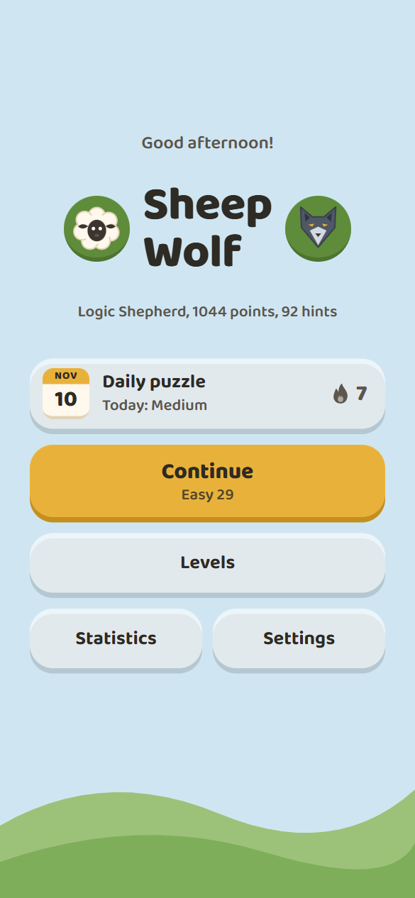
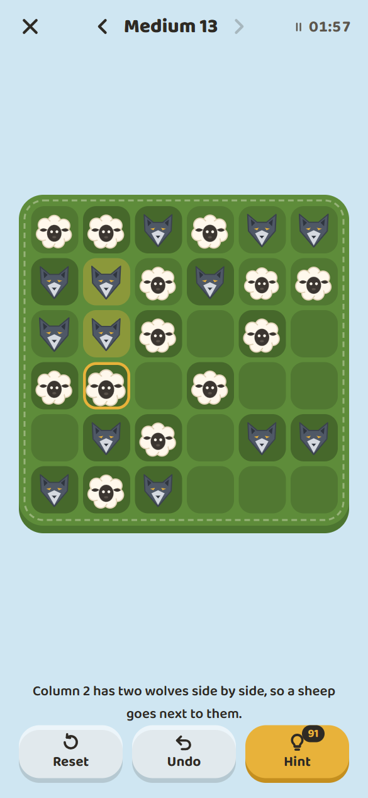
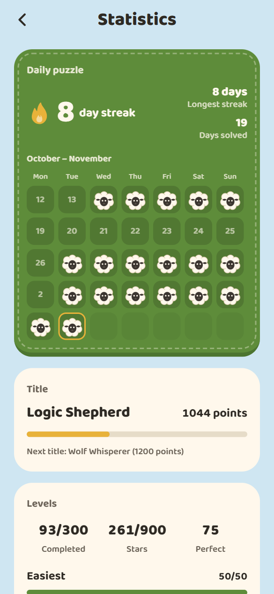
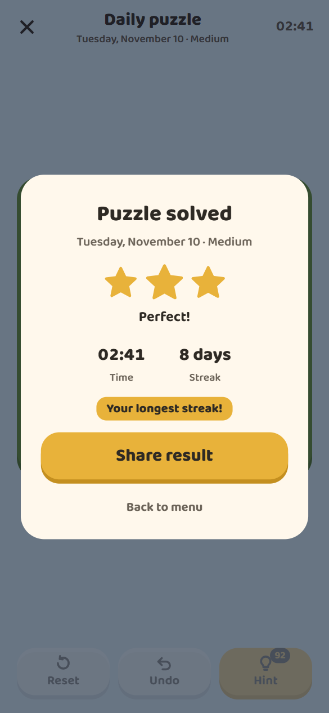
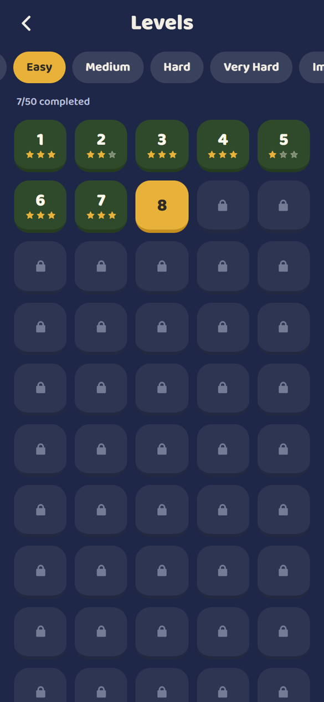
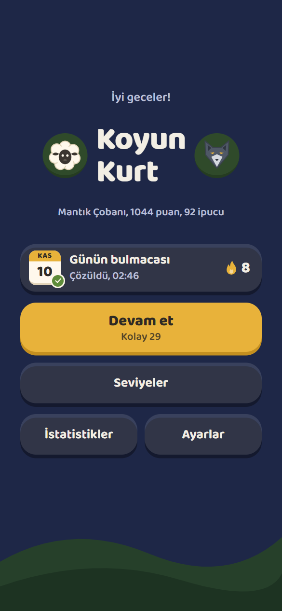

**English** | [Türkçe](README.tr.md)

# Sheep & Wolf

A calm logic puzzle for your phone: fill a 6×6 pasture with sheep and wolves so that no three of the same animal stand side by side and every row and column holds 3 of each. 300 hand-checked levels and a new daily puzzle every day, fully offline.

**[Download on the App Store](https://apps.apple.com/app/koyun-kurt-sheep-wolf/id6829908940)**

## Features

- **300 fixed levels** across 6 difficulties (Easiest, Easy, Medium, Hard, Very Hard, Impossible), 50 each. Every puzzle has exactly one solution.
- **Difficulty by starting pieces:** Easiest starts with 24 of 36 cells filled, Impossible with only 7.
- **Start at any difficulty:** the first level of every difficulty is open; inside a difficulty, finishing a level unlocks the next one. Continue picks up the difficulty you played last, and the level picker shows your stars.
- **A daily puzzle and a streak:** a new puzzle every day, generated on the phone from the date, so everyone gets the same one without a server. The week starts with Easy on Monday and ends with Impossible on Sunday. Solve it every day to grow your streak; every solved day puts a sheep on the streak calendar.
- **Statistics:** current and longest streak, a five-week calendar, progress towards the next title, and for each difficulty the levels finished, stars, best time and average time.
- **Daily reminder (optional):** a local notification at the hour you pick, only on days you haven't solved the daily puzzle yet. Permission is asked only when you turn it on, and nothing goes through a server.
- **A clock for every level:** each difficulty has a fixed time limit, from 30 seconds on Easiest to 7 minutes on Impossible; the first 5 Easiest levels are untimed so new players can learn the rules first. If time runs out, the level is lost and you try again. Tap the clock to pause; the game also pauses when the app goes to the background. The limit can be turned off in Settings.
- **Hints that explain:** a hint shows the next logical step and why ("Column 2 has two wolves side by side, so a sheep goes next to them") and highlights the pieces behind it; if you placed a wrong piece, it removes that first. All 300 levels can be finished with hints alone. Fewer hints mean more stars, and you get 5 new hints every day.
- **Undo:** take back your moves one by one, Reset included.
- **Mistakes show when the board is full:** red marks and one short sound appear only once every cell is filled, so tapping at random can't solve a puzzle. A clear message says what is wrong.
- **Best times:** every level keeps your fastest time, and beating it shows "New record!".
- **Pick up where you left off:** leave a level or close the app, and the board, the hints and the clock are waiting when you come back.
- **Sky that follows the clock:** morning, afternoon, evening and night colors. The board and pieces stay the same.
- **Drawn pieces and sounds:** the round sheep and the angular wolf can be told apart by shape alone. All sounds are synthesized in the project to match the drawings.
- **Turkish and English**, tutorial on first launch, sound, haptics and time limit settings, share your result (levels and the daily puzzle) as an image.
- **Offline and private:** no account, no ads, no data leaves the phone.

## Screenshots

| Menu | Game | Statistics |
|---|---|---|
|  |  |  |

| Daily puzzle solved | Levels | Turkish, night |
|---|---|---|
|  |  |  |

## Tech Stack

- React Native, Expo and Expo Router
- TypeScript
- Zustand with AsyncStorage (progress stays on the device)
- React Native Reanimated, react-native-svg, expo-audio, expo-haptics, expo-sharing
- expo-notifications for the daily reminder (local notifications only, no push)
- Node.js test runner with tsx
- EAS Build and EAS Submit for the App Store build

## Installation

### iPhone

Install **Koyun & Kurt** from the [App Store](https://apps.apple.com/app/koyun-kurt-sheep-wolf/id6829908940). It is free, with no ads and no in-app purchases.

### Run from source

Requires Node.js 20 or newer.

```bash
npm ci
npx expo start
```

Press `w` to open the web version in a browser. To run it on a phone with Expo Go, the Expo Go version has to match the project's Expo SDK. Reminders need a real build, because notifications are not available on the web or in Expo Go.

### Tests and tools

```bash
npm test                    # levels, rule engine, hints, daily puzzle, streaks, statistics, reminders and saves
npm run lint
npm run generate-levels     # rebuilds src/constants/levelData.ts (same result every time)
python scripts/make-sounds.py   # synthesizes the sounds (numpy, scipy, ffmpeg)
python scripts/make-icons.py    # renders the icons (playwright, Edge)
```

### Build for the App Store

```bash
npx eas-cli build -p ios --profile production --auto-submit
```

## What I Learned

- Generating puzzles with a single solution: I fill a valid board with backtracking, then remove cells one by one and put a cell back whenever the puzzle stops having exactly one answer.
- Making generated content reproducible: a seeded random number generator writes the same 300 levels every time, and tests check each one.
- Building a daily puzzle without a server: the date is the seed, so every phone generates the same puzzle. I only keep puzzles that the hint engine can solve without revealing an answer, so each day can be solved by reasoning alone.
- Writing a hint engine that explains itself: it looks for the simplest rule that decides a cell (two in a row, a gap between two, a full row), then reasons about a whole row or column. A test solves all 300 levels with hints alone.
- Showing mistakes only when the board is full, so the game rewards reasoning instead of trial and error.
- Keeping the game logic out of the screens. The rule engine is plain TypeScript, so I can test it with Node without a phone; the level and daily screens share one play area component.
- Not storing state that can go stale: the red error marks lived on each cell, and Reset forgot to recompute them for the given pieces. Now every board change goes through one function that recomputes them, and a test plays 18,000 random moves across all 300 levels to check that the marks always match the board.
- Computing streaks and statistics from the saved results instead of keeping separate counters, so they can never disagree with the data.
- Scheduling local notifications one by one for the next 7 days instead of one repeating notification, so a day whose puzzle is solved can be skipped, and asking for permission only when the player turns reminders on.
- Saving an unfinished level safely: the board and the clock are written to the phone when the player leaves or the app goes to the background, and everything read back is validated, so a broken or outdated save simply starts the level fresh.
- Making storage survive corrupt files: zustand's JSON storage never finished loading a broken file, so I wrapped it, and every field read back is checked without deleting the player's progress.
- Pausing the game with React Native's AppState, so time only runs while the game is on screen.
- Managing state with Zustand and saving it with AsyncStorage, including a version number and a migration when the level format changed.
- Expo Go only runs packages that ship inside it, so I moved from native Firebase to the JavaScript SDK first, and later removed online features to keep the game offline.
- Drawing the pieces with SVG and designing them so shape, not color, tells them apart.
- Synthesizing the sounds myself in Python instead of using recordings, matching their loudness, and playing one short sound at a time so they never pile up.
- Respecting the system "reduce motion" setting and labeling every cell for screen readers.
- Building an Android APK in the cloud with EAS Build.
- Shipping to the App Store from Windows: cloud iOS builds with EAS, a privacy manifest and privacy policy page, store screenshots in the required sizes, and a second submission with review notes and a screen recording after App Review asked for more information.

## License

[MIT](LICENSE)
