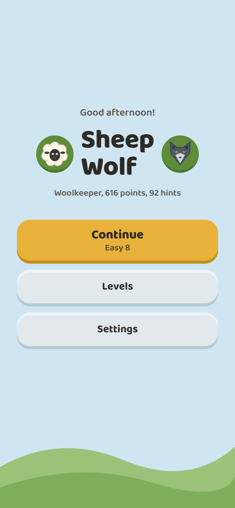
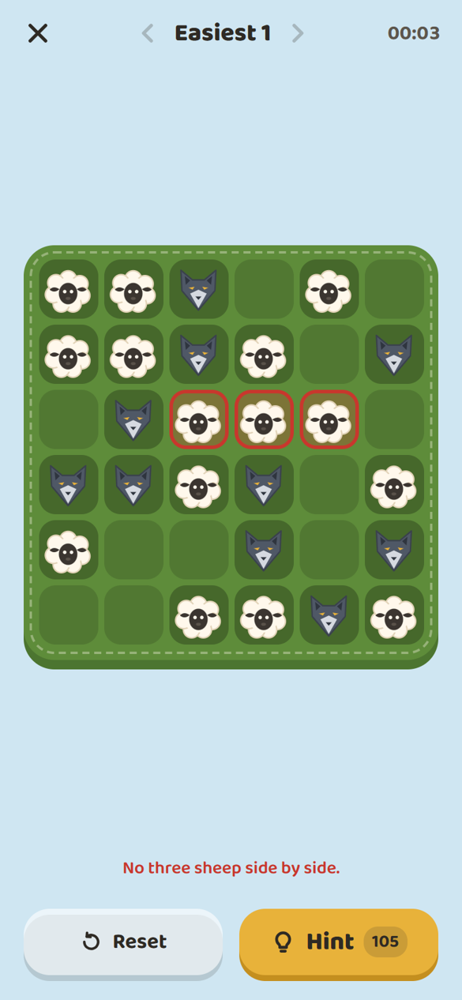
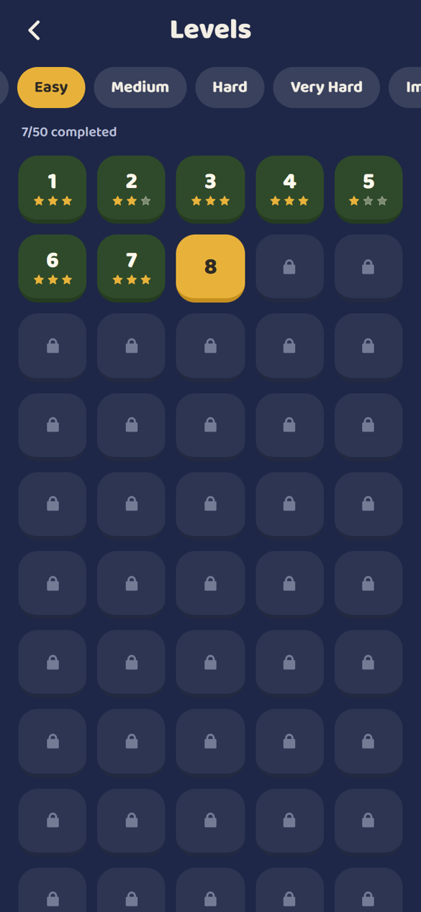
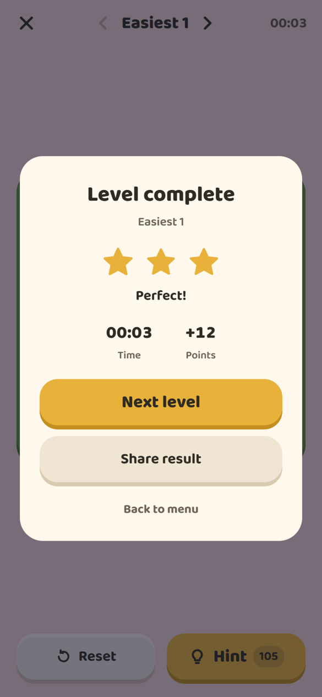
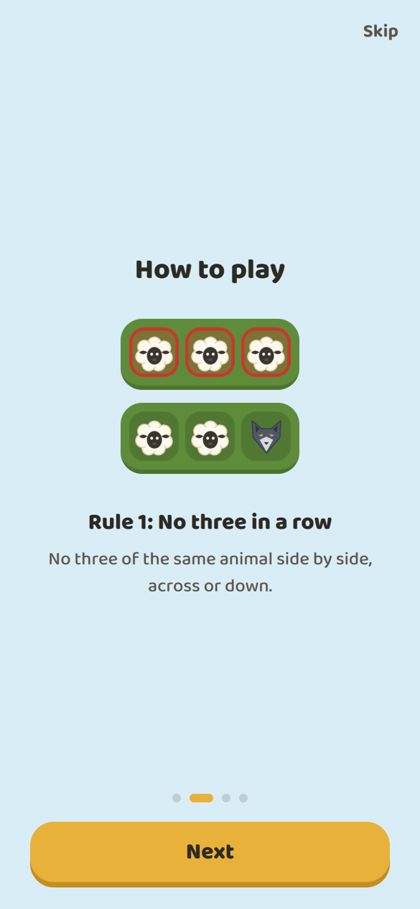
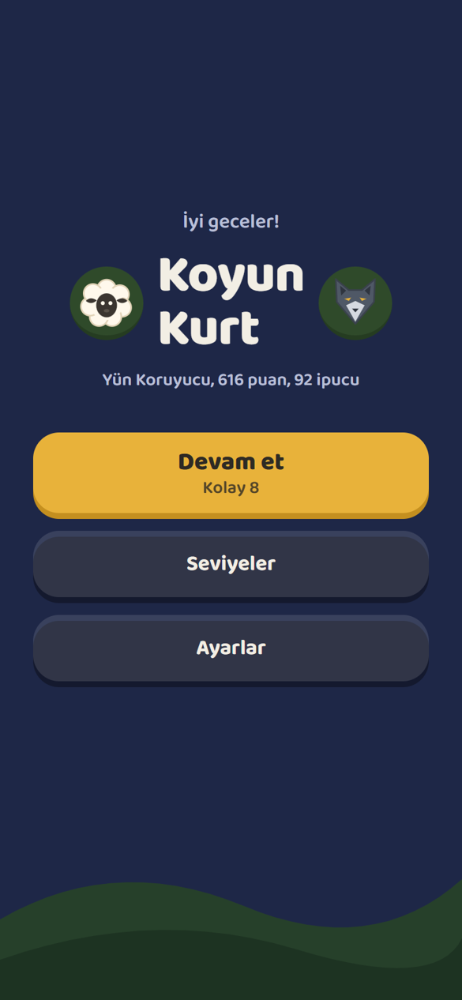

[English](README.md) | **Türkçe**

# Koyun & Kurt

Telefon için sakin bir mantık bulmacası: 6×6'lık merayı koyun ve kurtlarla doldur; aynı hayvan yan yana üç kez gelmesin, her satır ve sütunda 3 koyun ve 3 kurt olsun. Hepsi kontrol edilmiş 300 seviye, tamamen internetsiz.

**[APK'yı indir](https://github.com/MrcDprm/wolf-sheep-binaire/releases/latest)** · Yakında App Store ve Google Play'de

## Özellikler

- **300 sabit seviye:** 6 zorluk (En Kolay, Kolay, Orta, Zor, Çok Zor, İmkânsız), her birinde 50 seviye. Her bulmacanın tek bir çözümü var.
- **Zorluk başlangıç taşlarıyla:** En Kolay'da 36 hücrenin 24'ü dolu başlar, İmkânsız'da sadece 7'si.
- **Kilitli ilerleme:** bir seviyeyi bitirince sonraki açılır. Seviye seçme ekranında yıldızlar görünür, oyun ekranındaki oklarla seviyeler arasında geçilir.
- **Hatanı duy:** yan yana üç koyun gelince meleme, üç kurt gelince uluma başlar ve sen düzeltene kadar susmaz. Ekrandaki mesaj neyin yanlış olduğunu söyler.
- **İpucu ve yıldızlar:** ipucu boş ya da yanlış bir hücreyi düzeltir. Daha az ipucu, daha çok yıldız demek; her gün 5 yeni ipucu gelir.
- **Saate göre gökyüzü:** sabah, öğle, akşam ve gece renkleri. Tahta ve taşlar hep aynı kalır.
- **Çizilmiş taşlar ve sesler:** yuvarlak koyun ile köşeli kurt sadece şekilden ayırt edilebilir. Bütün sesler projede sentezlendi.
- **Türkçe ve İngilizce**, ilk açılışta eğitim, ses ve titreşim ayarları, sonucu görsel olarak paylaşma.
- **İnternetsiz ve gizli:** hesap yok, reklam yok, hiçbir veri telefondan çıkmaz.

## Ekran Görüntüleri

| Menü | Oyun | Seviyeler |
|---|---|---|
|  |  |  |

| Seviye tamamlandı | Eğitim | Türkçe, gece |
|---|---|---|
|  |  |  |

## Kullanılan Teknolojiler

- React Native, Expo ve Expo Router
- TypeScript
- Zustand ve AsyncStorage (ilerleme telefonda kalır)
- React Native Reanimated, react-native-svg, expo-audio, expo-haptics, expo-sharing
- tsx ile Node.js test aracı
- Android APK için EAS Build

## Kurulum ve Çalıştırma

### Android

1. `koyun-kurt.apk` dosyasını [son sürümden](https://github.com/MrcDprm/wolf-sheep-binaire/releases/latest) indir.
2. Telefonunda aç. Android sorarsa bu kaynaktan uygulama yüklemeye izin ver.
3. Ana ekrandan **Koyun & Kurt**'u aç.

### Kaynak koddan çalıştırma

Node.js 20 ya da üstü ve telefonda Expo Go uygulaması gerekir.

```bash
npm ci
npx expo start
```

Karekodu Expo Go (Android) ya da Kamera uygulamasıyla (iPhone) okut. Tarayıcıda web sürümünü açmak için `w` tuşuna bas.

### Testler ve araçlar

```bash
npm test                    # seviye verisi, kilitler ve kural motoru
npm run lint
npm run generate-levels     # src/constants/levelData.ts dosyasını yeniden üretir (her seferinde aynı sonuç)
python scripts/make-sounds.py   # sesleri sentezler (numpy, scipy, ffmpeg)
python scripts/make-icons.py    # ikonları çizer (playwright, Edge)
```

### APK derleme

```bash
npx eas-cli build -p android --profile apk
```

## Öğrendiklerim

- Tek çözümlü bulmaca üretmeyi öğrendim: önce geri izleme (backtracking) ile kurallara uyan dolu bir tahta kuruyorum, sonra hücreleri tek tek siliyorum; bulmacanın tek bir cevabı kalmayınca o hücreyi geri koyuyorum.
- Üretilen içeriği tekrarlanabilir yapmayı öğrendim: tohumlu bir rastgele sayı üreteci her seferinde aynı 300 seviyeyi yazıyor, testler de her birini kontrol ediyor.
- Oyun mantığını ekranlardan ayrı tuttum. Kural motoru düz TypeScript olduğu için telefona gerek kalmadan Node ile test edebiliyorum.
- Durumu Zustand ile yönetip AsyncStorage ile kaydettim; seviye biçimi değişince sürüm numarası ve geçiş (migration) ekledim.
- Expo Go sadece içinde gelen paketleri çalıştırıyor. Bu yüzden önce yerel Firebase'den JavaScript SDK'sına geçtim, sonra oyunu internetsiz tutmak için çevrimiçi özellikleri kaldırdım.
- Taşları SVG ile çizdim ve onları rengin değil şeklin ayırt etmesi için tasarladım.
- Hata sürdükçe sesi döngüde çaldırmayı ve sesleri kayıt yerine kendim sentezlemeyi öğrendim.
- Sistemdeki "hareketi azalt" ayarına uymayı ve her hücreyi ekran okuyucu için etiketlemeyi öğrendim.
- EAS Build ile Android APK'yı bulutta derledim.

## Gelecek Planları

- Google Play ve App Store'da yayınlamak.
- İsteğe bağlı bulut yedeği.

## Lisans

[MIT](LICENSE)
